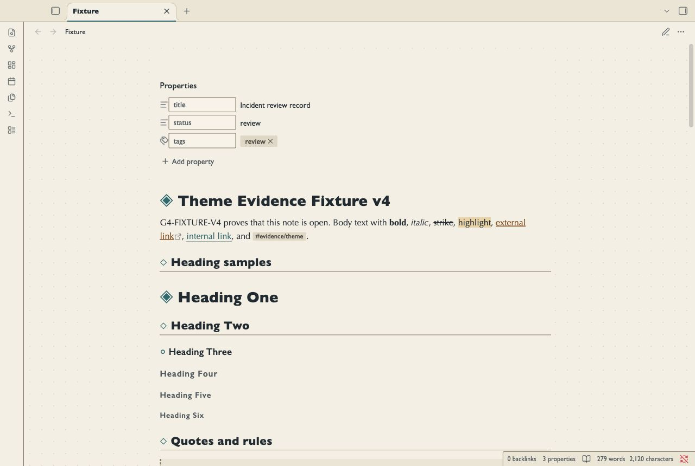
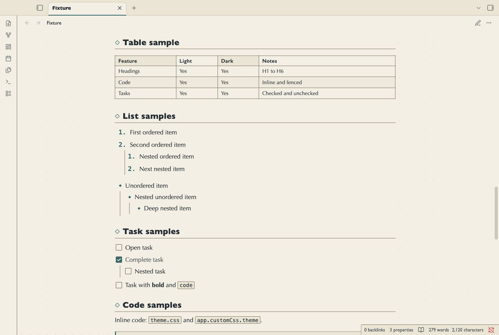
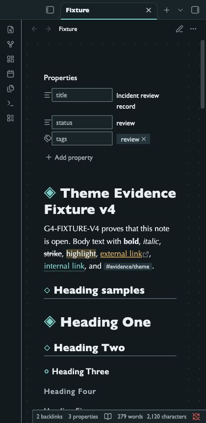

# Waypoint Atlas

Waypoint Atlas is for location journals, region indexes and linked project maps.
Sand and deep blue backgrounds support teal route marks.
Diamond headings mark stops in Reading view and Live Preview. Tables read like chart legends.
Callouts, code and embeds use a route rail along their left edge.

## Screenshots

These images show the desktop renderer with a test note.






## Install

1. Download `theme.css` and `manifest.json` from this repository.
2. Open your vault folder.
3. Create `.obsidian/themes/Waypoint Atlas/`.
4. Copy both files into that folder.
5. Open Settings in Obsidian.
6. Select Appearance.
7. Select Waypoint Atlas in the theme list.

Use the folder name `Waypoint Atlas`, as written in the manifest.
The repository name is not the installation folder name.

## Uninstall

1. Open Settings, then Appearance.
2. Select the default theme.
3. Remove `.obsidian/themes/Waypoint Atlas/` if you no longer need it.

Your notes remain in the vault.

## Compatibility

The minimum declared Obsidian version is 1.5.0.
The desktop renderer was tested with Obsidian 1.14.4.
Mobile was not tested. A narrow desktop capture does not test a mobile device.

## Customize

Use a CSS snippet in Settings, then Appearance.
The theme uses system fonts. It has no Style Settings panel.

```css
body.theme-light,
body.theme-dark {
  --file-line-width: 42rem;
  --atlas-grid: transparent;
  --font-text-theme: "Trebuchet MS", sans-serif;
}
```

`--atlas-grid` controls the decorative survey grid.
The grid appears in the margins outside the solid note sheet in both views.
It does not mark a control, table cell or content boundary.
It is intentionally faint. Structural borders use a separate contrast-tested token.
`--atlas-rail` controls the code, embed and navigation rails.
Callout rails retain the color for their type.
`--atlas-marker` controls waypoint glyphs.
`--atlas-water` controls the embed background.
Primary controls and route marks use fixed teal colors. Use theme variables in a CSS snippet to change them.
Check text and border contrast after you change colors.

## Known limits

- The survey grid is decorative. It does not align to text baselines or map coordinates.
- Diamond heading marks are CSS decoration. They are not note text or navigation controls.
- Optima and Gill Sans depend on installed fonts. Fallback fonts can change line breaks.
- Wide tables and code blocks can need horizontal scrolling.
- Callout families use distinct rail colors and icons. Related types share a color. Warning and danger callouts also have distinct borders.
- The theme styles notes. It does not create maps or change graph positions.
- Plugin views can use their own styles. They were not part of the fixture test.
- The native ribbon, tab headers, status bar, and file list were not reached by the Tab trace in Obsidian 1.14.4.
- The editor shows focus with a teal viewport rail and a clear caret.
- The oldest declared app version was not tested.
- Automated contrast checks do not certify WCAG conformance. Screen reader use has not been tested.

## License

[MIT License](LICENSE). Copyright 2026 NoteMods.
NoteMods maintains this theme.
