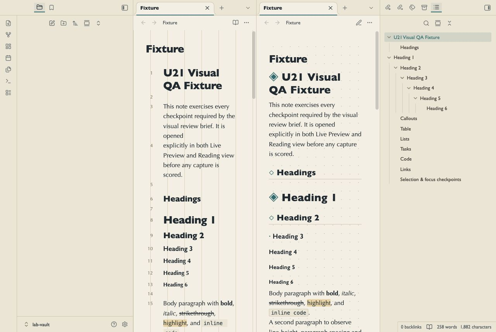
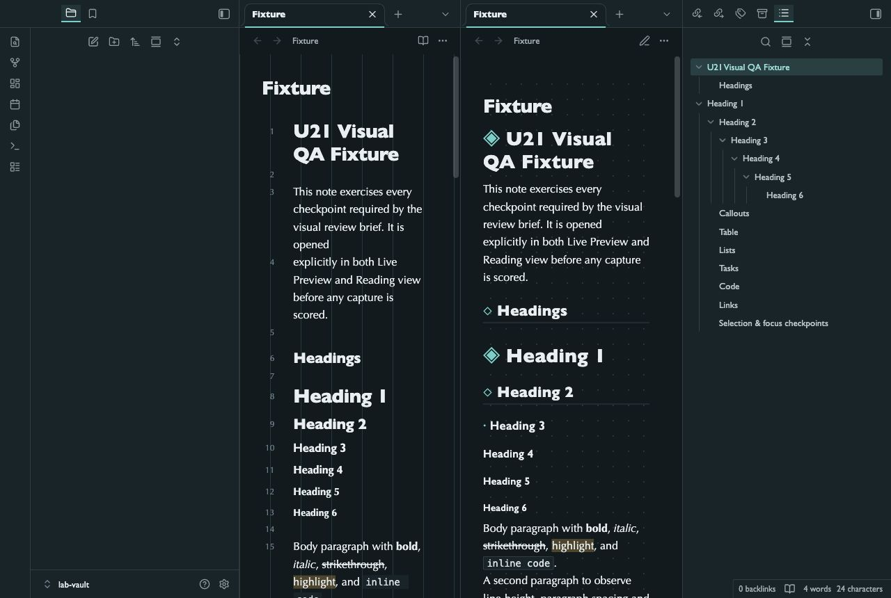

# Waypoint Atlas

Map markers and dotted surfaces for your location notes and indexes.

This is a preview theme with light and dark modes.

## Preview status

An independent review scored this version 75/100 on 14 October 2026.
The NoteMods acceptance gate requires at least 95/100. This version remains on hold.
Obsidian directory approval is not claimed.

## Design

- Waypoint heading markers.
- Route rails on callouts.
- Dotted internal links.

These styles change presentation. They do not add application features or plugins.

## Screenshots

These are unaltered captures from Obsidian 1.14.4 with a test note.
They show Live Preview and Reading view side by side.

### Light mode

### Dark mode

## Install the preview

1. Download `theme.css` and `manifest.json` from the `1.0.0` release.
2. Open your vault folder. Show hidden folders if necessary.
3. Create `.obsidian/themes/Waypoint Atlas/` inside the vault.
4. Put both files in that folder. Keep their file names unchanged.
5. Open Obsidian. Go to Settings, then Appearance.
6. Select `Waypoint Atlas` in the Themes list. Restart Obsidian if it is absent.

You can also copy these two files from the repository.
The manifest declares Obsidian 1.5.0 as the minimum version.
The captures verify only the desktop version stated above.

## Remove the preview

Select the default theme in Settings, then Appearance.
You can then remove the `Waypoint Atlas` folder from `.obsidian/themes/`.
Your note files remain in your vault.

## Known limits

- Desktop captures use Obsidian 1.14.4. Real mobile device use has not been verified.
- A narrow desktop capture does not prove mobile compatibility.
- Full keyboard navigation and assistive technology checks remain incomplete.
- Decorative separators can have low contrast. This theme has no accessibility certification.
- Font rendering can change with your operating system and installed fonts.
- Community plugins can change the layout. Their compatibility has not been verified.

## Feedback

Open an issue with your Obsidian version, operating system, selected mode, and steps to reproduce the problem.
Use a test note. Remove personal information from screenshots before you send them.

## Credits and licence

The original manifest credits Visual Thinking Factory (U19).
NoteMods maintains this preview repository. The original CSS, manifest, and licence are preserved.
See [LICENSE](./LICENSE) for the MIT terms.

[View the NoteMods catalog](https://notemods.com/themes/).
